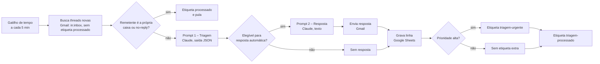

# Agente de Triagem e Resposta Automática de E-mails

Projeto Final do curso **Geração Tech – IA Generativa** (FIEC/IEL-CE).

Fluxo automatizado end-to-end que monitora uma caixa do Gmail, classifica cada e-mail com um LLM (prioridade, intenção e sentimento), registra o resultado no Google Sheets e responde automaticamente aos casos de baixa complexidade. Os casos urgentes ficam sinalizados para revisão humana.

- **Ferramenta de automação:** Google Apps Script (fluxo nativo do Google Workspace)
- **LLM:** Claude (modelo `claude-haiku-5-5`, via API da Anthropic)
- **Integrações:** Gmail, Google Sheets, Anthropic API

---

## 1. Descrição do problema

Uma pequena equipe de atendimento recebe e-mails de natureza muito diferente na mesma caixa: dúvidas simples, elogios, pedidos de agendamento, reclamações urgentes e spam. Hoje cada mensagem precisa ser lida e encaminhada manualmente.

As consequências são:

- **Demora em casos urgentes:** uma cobrança indevida ou um cliente sem acesso ao serviço pode ficar horas sem resposta, porque está no meio de dúvidas comuns.
- **Trabalho repetitivo:** perguntas frequentes (horário, agendamento, confirmação) consomem tempo de quem deveria cuidar de casos complexos.
- **Falta de registro:** sem uma planilha, não há visão do volume, dos temas recorrentes nem do sentimento dos clientes.

O fluxo resolve esses três pontos: prioriza o que é urgente, responde o que é simples e registra tudo para análise.

---

## 2. Engenharia de prompts

Os prompts completos, com instruções do sistema, variáveis, mensagem do usuário, exemplos de entrada e saída e salvaguardas, estão em [`docs/prompts.md`](docs/prompts.md).

Resumo:

| Prompt | Quando roda | Saída |
|---|---|---|
| **1. Triagem** | Para cada thread nova | JSON com `prioridade`, `intencao`, `sentimento`, `complexidade`, `resposta_automatica` e `resumo` |
| **2. Resposta** | Só se o prompt 1 liberar a resposta automática | Texto do e-mail, em no máximo 6 linhas |

Decisões de engenharia de prompt:

- **Saída em JSON com schema fixo**, pedida na instrução do sistema e validada pelo código (extração do objeto JSON e checagem do campo `prioridade`), para gravar os campos no Sheets sem interpretação de texto livre.
- **Regras explícitas de decisão** (ex.: reclamações nunca recebem resposta automática) escritas no prompt e também reforçadas no código, para não depender só do modelo.
- **Corpo do e-mail entre delimitadores** (`<<<` e `>>>`) e instrução para ignorar comandos dentro do texto, como defesa contra injeção de instruções.
- **Prompt 2 sem invenção de dados:** não cita preços, prazos ou políticas. Quando não sabe, promete retorno da equipe.

---

## 3. Arquitetura da solução

### Visão geral



### Nós e etapas

| # | Etapa | Componente | Entrada | Saída |
|---|---|---|---|---|
| 1 | Gatilho | Trigger de tempo (`processarEmails`, 5 min) | – | Execução |
| 2 | Busca | `GmailApp.search` | Caixa de entrada, últimos 2 dias, sem etiqueta `triagem-processado` | Até 20 threads |
| 3 | Filtro | Código | Remetente da mensagem mais recente | Pula se for a própria caixa ou no-reply |
| 4 | Triagem | Claude (prompt 1) | Remetente, assunto e corpo | JSON validado |
| 5 | Decisão | Código | JSON + regras de intenção | `elegivel` true/false |
| 6 | Resposta | Claude (prompt 2) + `msg.reply` | Assunto, intenção e corpo | E-mail enviado |
| 7 | Registro | `Sheet.appendRow` (aba `Triagem`) | Campos do JSON e status | Linha na planilha |
| 8 | Sinalização | Marcadores do Gmail | Prioridade alta | Etiqueta `triagem-urgente` |
| 9 | Controle | Marcador `triagem-processado` | – | Evita reprocessar a thread |

### Colunas da planilha

| Coluna | Conteúdo |
|---|---|
| A | Data e hora do processamento |
| B | Remetente |
| C | Assunto |
| D | Prioridade (alta, media, baixa) |
| E | Intenção |
| F | Sentimento |
| G | Complexidade |
| H | Resposta automática (sim/não) |
| I | Resumo gerado pelo LLM |
| J | Status (resposta enviada, revisão humana, registrado) |

### Tratamento de erros

- Falha em uma thread é registrada no log e a thread **não** é marcada como processada. Ela será tentada de novo na próxima execução.
- Erros temporários da API (429, 503 e 529, que é sobrecarga) geram até três tentativas, com espera de 5 e 10 segundos.
- O envio de resposta só ocorre se a regra de intenção e a complexidade baterem, mesmo que o modelo marque `resposta_automatica: true` para um caso que não deveria.

---

## 4. Resultados dos testes

> _(a preencher após a bateria de 15 casos, em [`docs/dataset-testes.json`](docs/dataset-testes.json))_

---

## 5. Como executar

### Pré-requisitos

- Uma conta Google dedicada ao projeto (usada como caixa de entrada e dona do script).
- Uma chave de API da Anthropic, criada em [console.anthropic.com](https://console.anthropic.com) com créditos adicionados.
- Uma planilha do Google Sheets com uma aba chamada `Triagem`.

### Passo a passo

1. **Criar o projeto:** em [script.google.com](https://script.google.com), crie um projeto chamado `triagem-emails`.
2. **Copiar o código:** substitua o conteúdo de `Código.gs` pelo arquivo [`apps-script/Code.gs`](apps-script/Code.gs).
3. **Configurar as propriedades:** em *Configurações do projeto → Propriedades do script*, adicione:
   - `ANTHROPIC_API_KEY`: a chave da Anthropic
   - `SHEET_ID`: o ID da planilha (trecho entre `/d/` e `/edit` na URL)
4. **Testar a classificação:** execute `testarClassificacao`, autorize o acesso na primeira vez e confira o JSON no log.
5. **Ativar o fluxo:** execute `setup`. Ele cria o gatilho de 5 em 5 minutos e os marcadores `triagem-processado` e `triagem-urgente`.

### Observações de segurança

- Nenhuma chave ou credencial entra no repositório. O `.gitignore` bloqueia `.env` e `.clasprc.json`.
- O script só lê a caixa de entrada e responde a e-mails de baixa complexidade.
- Para parar o fluxo, remova o gatilho em *Acionadores* do Apps Script.

---

## 6. Demonstração

O vídeo de 3 a 5 minutos segue o roteiro em [`docs/roteiro-video.md`](docs/roteiro-video.md).

---

## Estrutura do repositório

```
apps-script/
  Code.gs                 código do fluxo
docs/
  prompts.md              prompts completos, exemplos e salvaguardas
  dataset-testes.json     15 e-mails de teste com a classificação esperada
  roteiro-video.md        roteiro da demonstração
README.md
```
